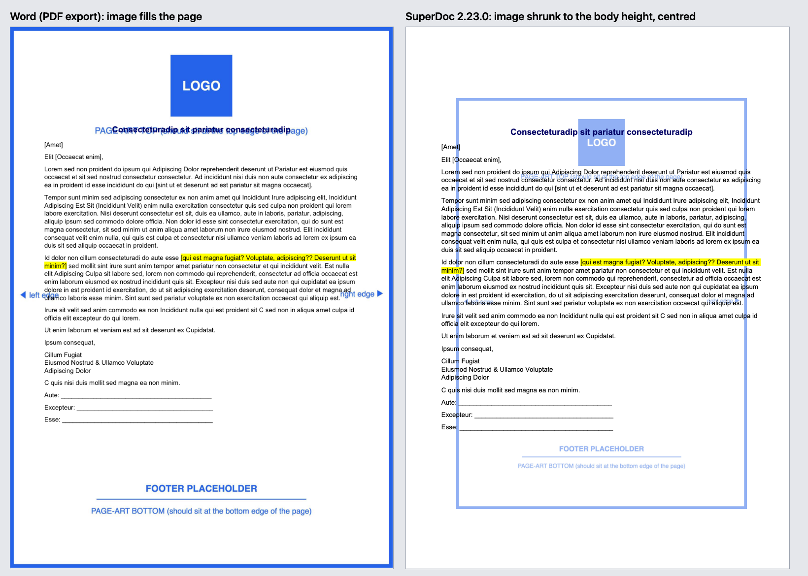

# SD-108 — Full-page header image is shrunk to the body height and centred

## Summary

A letterhead-style document carries its page art (logo at the top, footer band at the bottom) as one
image in the header: `behindDoc="1"`, `wrapNone`, with a `wp:extent` the size of the whole A4 page,
centred on the page. SuperDoc draws it at the height of the body area between the top and bottom
margins (width scaled to keep the aspect ratio) and then centres it. The logo ends up on top of the
title and the footer band floats in the middle of the page. Word draws it at its declared size, so
it covers the page.

Low priority: other non-Word renderers also get this file wrong (Word for the web's live view and
Google Docs). Word for the web's live view keeps the image at full size but places it about 1 cm low.



## Environment

- superdoc 2.23.0, bare `new SuperDoc(...)` mount via this repo's `harness/`, `editing` mode.
- Chromium (Playwright, headless), 900×1200. Node 24.
- Reference: the same file exported to PDF by Word for the web (Microsoft's server-side layout):
  [`screenshots/word-pdf-export.png`](screenshots/word-pdf-export.png).

## Fixture

[`page-art-shrunk.docx`](page-art-shrunk.docx): a one-page A4 letter (lorem ipsum text). The header image is a
placeholder with a blue frame along its edges, a "LOGO" box at the top and a "FOOTER PLACEHOLDER"
band at the bottom, so a correct render has the frame on the page edges.

Relevant markup (`word/header1.xml`, page `w:pgSz w:w="11906" w:h="16838"`, margins top 2608 / bottom 1701 twips):

```xml
<wp:anchor behindDoc="1" layoutInCell="1" allowOverlap="1" ...>
  <wp:positionH relativeFrom="column"><wp:align>center</wp:align></wp:positionH>
  <wp:positionV relativeFrom="page"><wp:align>center</wp:align></wp:positionV>
  <wp:extent cx="7542000" cy="10666800"/>   <!-- 20.95 × 29.63 cm: the whole page -->
  <wp:wrapNone/>
  ...
```

## Steps to reproduce

### UI steps
1. Open `harness/index.html?doc=SD-108/page-art-shrunk.docx&mode=editing`.
2. Look at page 1: the blue frame should run along the page edges, with LOGO above the title and the
   footer band at the bottom of the page.

### Script
`node SD-108/repro.mjs` reads the declared size from the docx, measures the rendered image, saves
`screenshots/superdoc-2.23.0.png` and `results-2.23.0.json`, and prints PASS when the image is drawn
smaller than its extent.

## Expected / Actual

| | Width | Height | Position |
|---|---|---|---|
| Declared (`wp:extent`, 96 dpi) | 792 px | 1120 px | centred on the page → covers it |
| Word (PDF export) | full page | full page | covers the page |
| **SuperDoc 2.23.0** | **591 px** | **835 px** | left 102, top 144 (centred) |

835 px is exactly the body height: page 1123 px − top margin 174 px − bottom margin 113 px.

## Root cause / analysis

Isolated by changing one attribute at a time (all still 591 × 835 on 2.23.0):

- `positionH relativeFrom="page"` instead of `column` → same size (and placed at left 30 px
  instead of centred, a separate positioning quirk).
- `positionV` as `posOffset 0` instead of `align center` → same size, moved to the top.
- Both offsets 0 → same size at the top-left corner.
- `behindDoc="0"` → same size.

So the size, not the position, is the trigger: an anchored, `wrapNone` image taller than the body area
is clamped to the body height instead of being allowed to extend into the margins.

## Suggested fix

Size floating (`wp:anchor`) images from `wp:extent` without clamping them to the content box. A
`wrapNone` / `behindDoc` image, especially one anchored in a header or footer and positioned relative
to the page, is expected to overlap the margins. Any fit-to-content clamp should apply to inline
(`wp:inline`) images only.

## Related

- SD-79: another case where header/footer drawing objects render differently from Word.
